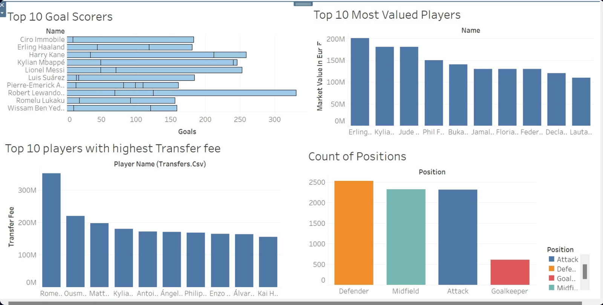
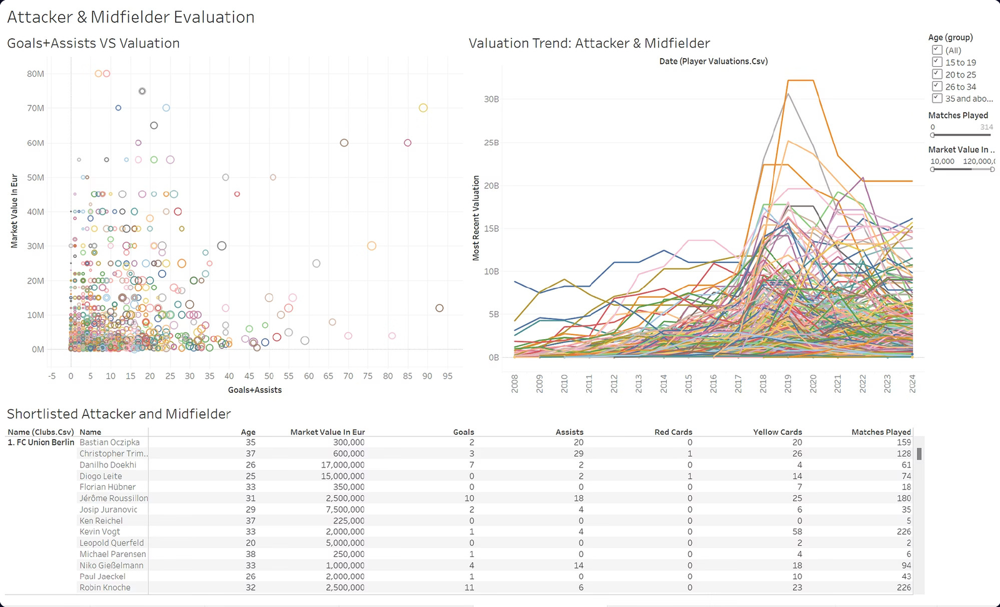
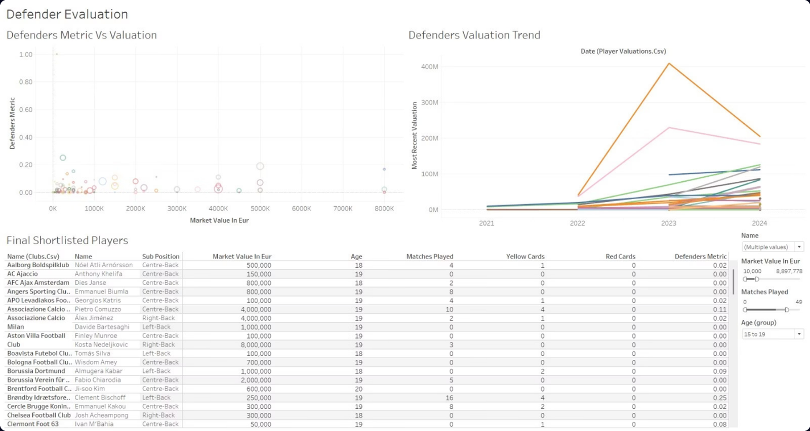
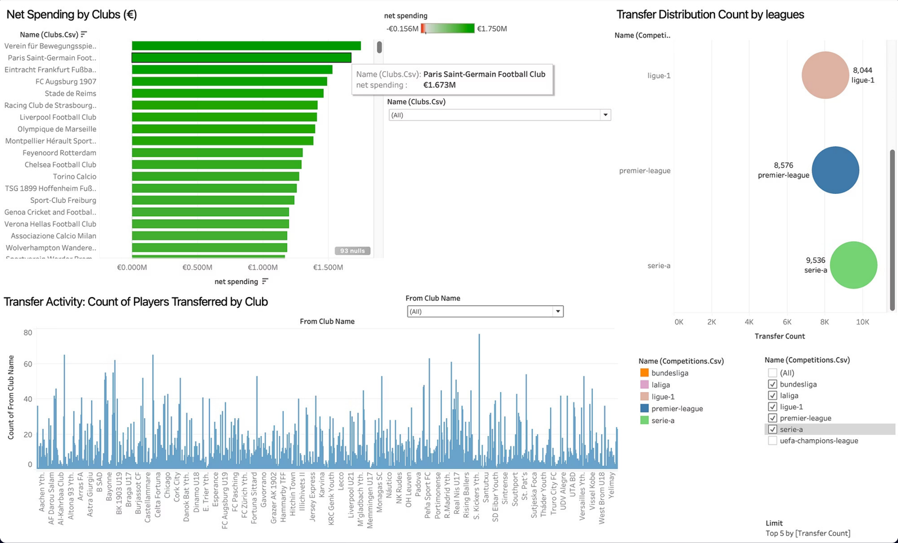
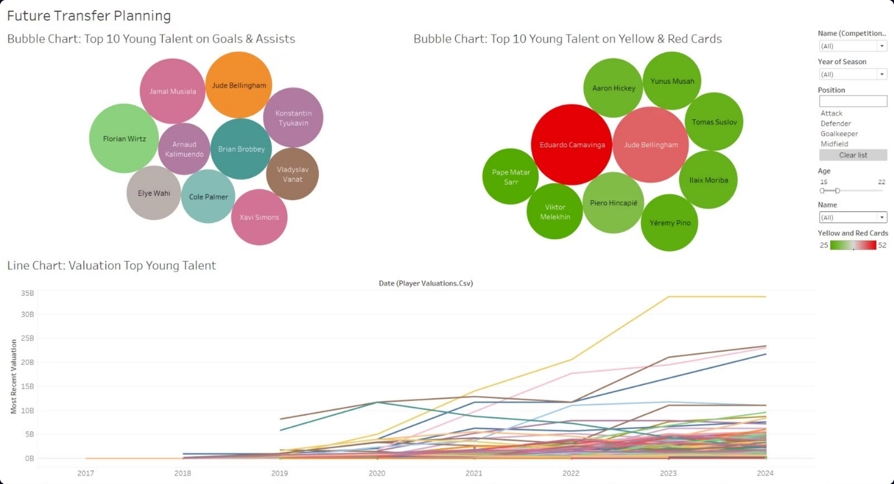

# San Diego FC Transfer & Scouting Dashboard (Tableau)

An interactive Tableau dashboard that helps San Diego FC's transfer strategy team shortlist players for its first MLS season, balancing on-field performance, market value and age within a $250M recruitment budget.

**Author:** Rishabh Soni · [LinkedIn](https://linkedin.com/in/rishabhsoni10)

*Developed from a course project in the MS in Business Analytics program at UC San Diego's Rady School of Management (2024).*

---

## Why it matters

A new club has no scouting history and a fixed budget. Instead of relying on reputation or intuition, the transfer team needs to compare thousands of players on the same footing: what they produce on the pitch, what they cost, how their value is trending and how they fit the squad. This dashboard brings that into one place, with filters for position, age, market value and experience so scouts can go from the whole market to a shortlist in a few clicks.

## Highlights

- **5 linked dashboards** covering the market overview, attackers and midfielders, defenders, transfer trends and young talent
- **Built on public Transfermarkt data from Kaggle:** appearances, player valuations, game events, transfers, clubs and competitions
- **Data cleaned in Tableau Prep** before analysis (workflow included in this repo)
- **Custom metrics** such as Goals + Assists and a Defenders Metric, compared against market value to surface undervalued players
- **Interactive filters** for age group, position, matches played, market value, competition and season

## Dashboards

### 1. Market overview
Top goal scorers, most valuable players, highest transfer fees and the squad-wide position mix.

### 2. Attacker and midfielder evaluation
Goals + Assists plotted against market value, valuation trends over time, and a shortlist table that updates with the filters.

### 3. Defender evaluation
A Defenders Metric plotted against market value to find effective defenders who cost less than their output suggests.

### 4. Transfer trends
Net spending by club, transfer volume by league and transfer activity by club, to show where the market is most active.

### 5. Future transfer planning
The top young players aged 15–22 by goals and assists and by disciplinary record, with their valuation trends.

## Results

- **Budget-friendly experience:** filtering for players with 250+ recorded matches and a market value of €5M or less produced a shortlist of 8 veterans worth about **€22M combined**, about a tenth of the budget. Cristiano Biraghi stood out with 15 goals and 37 assists at a €3.5M valuation.
- **Young defender scouting:** the defender view narrows the pool by age, market value and experience, for example to low-cost defenders aged 15–19, with each player's stats and valuation trend one click away.
- **Where the market is:** Serie A (9,536 transfers) and the Premier League (8,576) were among the most active leagues, both ahead of Ligue 1 (8,044). Paris Saint-Germain ranked among the top net spenders.
- **Long-term targets:** Jude Bellingham, Jamal Musiala, Florian Wirtz, Cole Palmer and Xavi Simons were among the top young talents on goals and assists. On discipline, Eduardo Camavinga and Bellingham were among the most carded in that group.

## Data preparation

The raw files were cleaned in Tableau Prep (`scouting_data_prep.tfl`) and filtered further in Tableau:

- Removed columns not needed for recruitment analysis: `coach_name`, `url`, `total_market_value` and `filename`
- Removed transfers with no recorded fee
- Renamed overlapping fields (`name` to `club_name`, `market_value_in_eur` to `player_market_value_in_eur`) so the tables join cleanly
- Excluded players inactive since 2015, to focus on current and emerging talent
- Aggregated match-level data into player-level metrics

## Tech stack

**Tableau Desktop** (dashboards, calculated fields, interactive filters) · **Tableau Prep** (data cleaning) · **Kaggle / Transfermarkt data**

## Files

- `1_player_overview.png` to `5_future_talent.png`: screenshots of the five dashboards
- `scouting_data_prep.tfl`: the Tableau Prep cleaning workflow
- `presentation.pdf`: slide deck walking through the dashboards and findings
